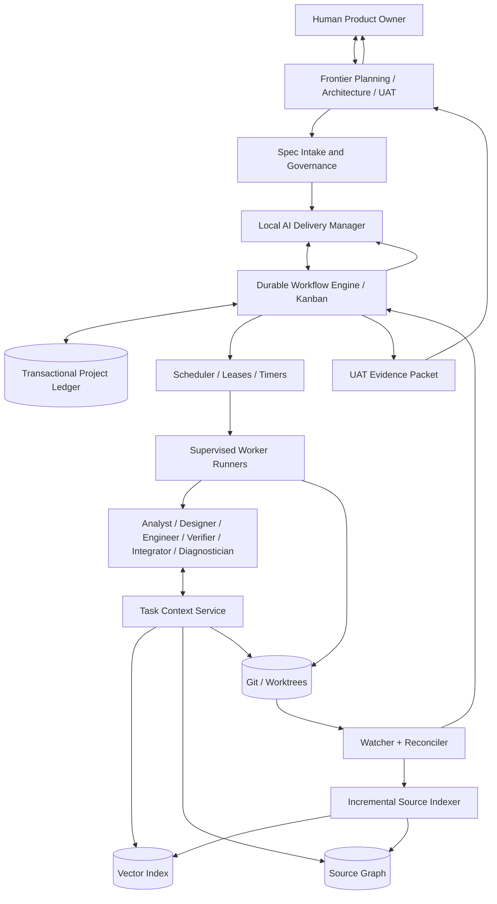

# SMART Resonance
## Greenfield Architecture and Implementation Design

**Status:** Implementation handoff, v1.0  
**Date:** 2026-11-03  
**Intended audience:** Codex, Claude, and human engineering reviewers  
**Target:** Deliver a working vertical slice within seven calendar days; establish the correct long-term architecture from day one.

> **Governing instruction:** This is a **greenfield product**, not a refactor of the current organically evolved agent system. Inspect the existing implementation and reuse proven components when they are genuinely compatible with this architecture, but do not inherit its coupling, data model, control flow, or limitations merely because code already exists. Optimize for the strongest useful deliverable within the week, **without sacrificing the future architecture to achieve a demo**.

---

## 1. Executive Summary

**SMART Resonance** is a local-first, evidence-grounded software delivery system. A human and a frontier model establish the product intent and high-level specification. A locally hosted AI Delivery Manager decomposes that intent into managed, verifiable work. Specialized, empirically selected local AI workers perform analysis, design, implementation, review, integration, and diagnosis. Elixir/OTP provides reliable orchestration, supervision, timing, state control, and crash recovery. A continuously maintained source-awareness service gives each worker task-relevant evidence about the current repository. Successful local delivery culminates in a coherent build and acceptance-evidence packet for frontier-model/human UAT.

The system is not a chat-room swarm, not a set of personas applied to one generalist model, and not an endless auto-retry coding loop. It is a **managed delivery system centered on verified changes to software state**.

The core loop is:

```text
Intent → Charter → Reconnaissance → Work packages → Bounded execution
     → Observe evidence → Independent verification → Integration
     → Reconcile plan → Deliver for UAT
          ↘ exception → diagnose → replan / escalate / stop ↗
```

### Product promise

- Human supplies direction rather than supervising every code edit.
- Frontier inference is reserved for high-value planning, architectural decisions, material changes, and UAT.
- Local models handle the recurring, token-intensive implementation process.
- Every agent operates with epistemic humility: claims are provisional, evidence is inspectable, and verification is independent.
- Each attempt has an enforced time budget; stalled work transitions to diagnosis, not blind continuation.
- Agent memory is expendable. Institutional memory and work state are durable.
- Codebase indexing is incremental, provenance-aware, and separate from authoritative Git/project records.
- The system can be stopped and restarted without losing the ability to explain what happened or what to do next.

**Economic intent:** Avoid metered cloud inference for routine work, while recognizing local compute, electricity, and human time still have costs.

---

## 2. Architectural North Star and Greenfield Rules

### 2.1 Design the destination, then implement vertical slices

The future system, not the current implementation, defines the module boundaries. The first-week product should be the smallest complete enactment of that architecture: one real project, one real spec, one real task, one supervised local worker, one bounded attempt, one observed diff, one independent gate, one integration path, and one UAT packet.

**Do not** build a disposable mock workflow, an isolated swarm proof-of-concept, or a new UI over the old planner. **Do** build durable ports/interfaces and a tested path end to end, even if only a few adapters and one specialist model are initially configured.

### 2.2 Reuse policy: intentional, never automatic

Evaluate each legacy component for: (1) correctness, (2) isolation, (3) observability, (4) replaceability, (5) testability, (6) local/offline operation, and (7) fit to the target contracts.

| Existing asset | Planned disposition |
|---|---|
| EmbeddingGemma 2 embedding pipeline | **Strong reuse candidate** behind an EmbeddingProvider interface. Verify model identity, dimensions, runtime requirements, licensing, and batching. |
| Qdrant vector storage | **Reuse candidate**, initially acceptable vector backend behind VectorIndex. Retain or consolidate based on measured retrieval quality, resource use, and migration cost. |
| Tree-sitter / source analysis | **Strong reuse candidate** behind SourceAnalyzer; preserve incremental parsing and symbol provenance. |
| SQLite three-hop relationship graph | **Migration input / fallback**, not the long-term graph architecture. |
| Proposed Ladybug graph engine | **Target graph adapter** if validated; prefer a supervised external service where native crash isolation is important. |
| File watcher + change notification | **Strong reuse candidate** as a *hint source*, not a source of truth or task-completion detector. |
| Existing planner | **Reference implementation / logic donor**; new Delivery Manager and deterministic workflow engine are distinct components. |
| Current SQLite Kanban + git-bug | **Migration / integration candidate**; new core owns durable work state, with git-bug as an optional import/export or synchronization adapter. |
| Existing Claude/Codex pair-programming bridge | **Potential worker collaboration adapter**, provided its protocol, privilege boundaries, and operating costs are explicitly evaluated. Do not assume implementation details. |

A component is **not** reused if adapting it requires compromising the target abstraction. Document keep/adapt/replace decisions in short architecture decision records (ADRs).

### 2.3 Non-negotiable invariants

1. **Git is authoritative for source content**; a transactional project ledger is authoritative for work status and decisions. Indexes are rebuildable projections.
2. **No model can mark its own work verified or integrated.**
3. **Agent exit does not mean task success.** A watcher event does not mean task success.
4. **No unbounded retry, token consumption, elapsed execution, or context growth.**
5. **No silent scope changes.** Material changes require governed approval.
6. **Every meaningful claim has a traceable evidence source**, or is explicitly marked uncertain.
7. **Every execution is tied to a baseline revision, attempt ID, workspace, timebox, and declared authority.**
8. **Elixir controls orchestration**; specialist subprocesses can crash without corrupting authoritative state.
9. **Offline/local is the default**, with explicit opt-in for cloud/frontier calls and external network access.
10. **The human retains product authority**, including final acceptance and decisions that change intended scope.

---

## 3. System Boundaries and High-Level Topology



### 3.1 Control plane vs intelligence plane

**Control plane (deterministic Elixir/OTP):** workflow transitions, leases, timers, process lifecycle, policy enforcement, worktree ownership, concurrency locks, event recording, retries, cancellation, reconciliation, and evidence collection.

**Intelligence plane (model-backed):** interpreting intent, planning work, source investigation, task design, code generation, semantic review, diagnosis, risk assessment, and exception decisions.

**Knowledge plane (derived, rebuildable):** embeddings, parsed symbols, source graph, code/doc links, task context trails, test-to-code relationships where known.

**Evidence plane (durable, auditable):** commits/diffs, test output, execution metadata, decisions, approvals, source revisions, artifact hashes, and verified acceptance records.

The delivery manager makes judgments. It is **not** the scheduler, persistence engine, process supervisor, source of truth, or sole gatekeeper for completion.

### 3.2 Deployment target

Single-host, local-first deployment initially; multiple hosts and model backends later. Elixir/OTP is the long-lived coordinator. External model runtimes and native-risk engines operate as supervised subprocesses or services with explicit health checks. Do not assume BEAM supervision alone handles grandchildren or OS process trees; the runner must implement reliable subprocess-group termination.

Keep transport stable and versioned (JSON over local HTTP, Unix socket, or stdio, selected by implementation assessment). Prefer a simple, documented API over elaborate distributed messaging during week one.

---

## 4. Roles, Authorities, and Separation of Duties

Roles are **capability contracts**, not personalities or permanently running processes. Route each invocation to an eligible model using measured task performance and resource constraints. Multiple roles can share a model if needed, but verification should use independent context and preferably different tests or methods.

| Role | Responsibility | Inputs | Outputs | Forbidden actions |
|---|---|---|---|---|
| Human Product Owner | Establish and change intended outcomes; final accept/reject | Vision, material tradeoffs, UAT results | Intent, approval, acceptance | N/A |
| Frontier Architect / Sponsor | High-level spec, architectural decisions, material-change review, UAT assistance | Human direction, decision packets, delivery evidence | Spec, approved decisions, assessment | Unapproved changes to human product intent |
| **Delivery Manager (PM)** | Charter, decomposition, sequencing, resource allocation, risk/issue/change management, delivery forecast, exceptions | Spec, task ledger, dependencies, evidence summaries | Work packages, priorities, authorizations, escalation packets | Self-verifying implementation, silent scope changes |
| Analyst | Reconnaissance, requirement-to-code mapping, risk/unknown discovery | Task, indexed trail, source revision | Findings with citations, unknowns, impact map | Claiming unverified runtime behavior as fact |
| Designer | Detailed design and SMART task contracts | Charter, analyst findings, constraints | Acceptance criteria, implementation contract, test plan | Changing product requirements without approval |
| Engineer | Implement changes in assigned sandbox/worktree | Contract, evidence trail, tool access | Changed files, optional status notes, reproducible diff | Self-approval, modifying unauthorized paths |
| Verifier | Independently validate behavior, quality, security and regression risk | Contract, diff, test environment, evidence | Pass/fail/uncertain report with reproducible proof | Editing candidate implementation while reviewing it |
| Integrator | Conflict handling, controlled merge, integration tests, delivery assembly | Accepted changes and baseline | Integration revision and test report | Overriding failed gates without recorded authority |
| Diagnostician | Timeout/failure/postmortem and next-step hypotheses | Attempts, logs, diffs, test outputs, context | Root-cause hypothesis, evidence, bounded remediation proposal | Repeating failed attempt unchanged |

**Optional specialist capabilities** are plugins to these roles: security reviewer, UX reviewer, database migration specialist, performance profiler, documentation writer, dependency auditor, etc. Avoid creating a model-led management hierarchy for each specialty.

### 4.1 Delivery Manager: PMI-inspired operating model

- **Initiate:** create a project charter: objectives, deliverables, acceptance, scope exclusions, authority, resources, risks, constraints.
- **Plan:** deliverable-oriented work breakdown structure, dependency network, milestones, resource limits, critical path / bottleneck identification, SMART work packages.
- **Execute:** delegate work, not implementation minutiae; manage assignments, priorities, and blocked dependencies.
- **Monitor/control:** manage by exception, compare observed evidence with acceptance criteria and plan, forecast outcomes, handle risk and changes.
- **Close:** prepare UAT packet, obtain acceptance, close open work honestly, capture lessons learned.

Use a **hybrid/adaptive process**, not a mandatory sequential waterfall. Within a package, specialists may iterate, but every attempt has explicit bounds and every accepted state is evidence-based.

### 4.2 Management by exception

Routine, within-tolerance events do not require PM inference. Wake the PM only for decision-worthy situations, such as failed acceptance gates, repeated timeout, blocked critical dependency, conflicting changes, milestone forecast breach, insufficient resources, or a potential scope deviation. The workflow engine handles normal transitions deterministically.

### 4.3 Approval tiers

| Tier | Example | Decision owner |
|---|---|---|
| 0: Routine | Retry infrastructure error once under policy, run tests, reindex | Workflow engine |
| 1: Within contract | Select implementation, reorganize tasks, adjust sequencing | Specialist or PM as delegated |
| 2: Architectural | Break approved architectural constraint, choose major substitution | Frontier architect with recorded decision |
| 3: Product | Alter intended behavior, delivery scope, security/privacy promise, accepted tradeoff | Human, optionally advised by frontier architect |

Explicitly store approver, decision, rationale, affected requirements, and revised baseline. If frontier access is unavailable, pause only work that truly requires that approval; continue unrelated work.

---

## 5. Durable Domain Model

Use a transactional project store (SQLite with WAL is acceptable for single-host launch) behind repository interfaces. The event log and materialized board can share the database, but all state transitions must be atomic and idempotent. Never treat a prompt history as the authoritative work ledger.

**Entities (minimum useful schema):**

- `Project`: ID, repo root, charter version, accepted spec revision, status, privacy policy, resource limits.
- `Requirement`: stable ID, text, source, acceptance criteria, priority, version, approval state.
- `Milestone`: deadline/target, included deliverables, dependencies, acceptance and forecast.
- `WorkPackage`: ID, goal, dependencies, owner role, expected outputs, authorized scope, acceptance contract, time budget, status, priority, relevant requirement IDs.
- `Attempt`: ID, package ID, model/role/harness, task contract hash, baseline Git revision, worktree ID, start/deadline/finish, exit reason, tokens/compute estimates if available, evidence links.
- `Evidence`: type, source path/commit/test run, content hash, index generation, timestamp, assertion supported, confidence or uncertainty, producer.
- `Decision`: authority tier, proposal, options, rationale, approving actor, timestamp, impact, spec revision.
- `RiskIssue`: risk vs realized issue, owner, probability/impact or severity, trigger, mitigation, linked packages, status.
- `Event`: unique ID, aggregate, sequence/version, timestamp, cause, payload, correlation and idempotency keys.
- `ModelCapability`: model/harness ID, supported role/task types, context limits, memory/compute needs, local endpoint, quality and reliability observations.
- `WorkspaceLease`: task/worktree, lock scope, lease owner, lease expiry, fencing generation.

**Relationships:** requirement → deliverables → packages → attempts → code/test evidence → decisions → acceptance. Preserve this lineage in the ledger even if the knowledge graph is later rebuilt.

### 5.1 State machine

```text
PROPOSED → REFINED → READY → LEASED → RUNNING → RECONCILING
                                 ↘ timed out / crashed ↘
                        DIAGNOSIS ← INCOMPLETE / FAILED
                                      ↓
RECONCILING → REVIEW_READY → VERIFYING → ACCEPTED → INTEGRATING
                   ↖ changes needed ←   ↓            ↓
                                       REJECTED   INTEGRATED → CLOSED

Any phase → BLOCKED (dependency/approval)
Any phase → CANCELLED (authorized human/PM action)
```

Implement legal transitions and authorization checks as a table-driven state machine. Add a transition audit event in the same transaction as the state change. A task is only **CLOSED** after integration and required evidence, not because a process exited.

### 5.2 Event semantics

File events and embedding/graph notifications are **hints to reconcile**, not durable proof of completion. Prefer delivery of hints with at-least-once semantics and idempotent handling. Periodic scanning of relevant Git/worktree state and pending records repairs missed events. Where no worktree file changes occur, an attempt may still terminate and produce logs, analysis, or a legitimate `BLOCKED` outcome; the runner must always reconcile on exit/timeout.

Record baseline revision, observed worktree fingerprints (including untracked files), diff/patch hash, and index generation. If the index lags the worktree, context must either wait for a consistent generation or mark staleness and retrieve directly from Git/files with provenance.

---

## 6. Source Awareness and Task Context

### 6.1 Desired context architecture

Preserve the existing useful approach: EmbeddingGemma 2 for code/doc embeddings, a vector backend such as Qdrant, parsed code structure via Tree-sitter, and a graph of relevant source relationships. The long-term graph adapter may use Ladybug. Keep source graph and work ledger logically distinct even when interoperable.

**Source index fields:** repository and revision, path, language, AST node/symbol, byte/line span, content hash, embedding version, provenance, index generation, relationships (import/call/define/reference/test/doc when supported), parse/index status, confidence.

**Retrieval flow:**

1. Extract task objective and accepted constraints.
2. Retrieve relevant docs/code semantically.
3. Expand bounded structural neighbors (three hops is an initial policy, not a hard architectural limit; apply fanout and token budgets).
4. Add authoritative recent diffs, test results, and unresolved linked issues.
5. Rank for evidence quality and task relevance; deduplicate.
6. Return a compact typed **context packet** with navigable references and explicitly marked unknowns.
7. Refresh or invalidate packet if baseline/index generations diverge.

The index need not infer complete runtime behavior. It must instead distinguish directly observed syntax, inferred semantics, and unverified assumptions.

### 6.2 Scale design

The architecture must accommodate enormous, messy, pre-existing repositories eventually. Achieve this with incremental ingestion keyed by content hash, bounded batch sizes, backpressure, sharding/partition boundaries, selective graph traversal, index-version metadata, and the ability to rehydrate from Git. **Do not promise full billion-line indexing in week one.** Demonstrate correct incremental updates, changed-file invalidation, and retrieval provenance on a representative repository.

### 6.3 Ladybug decision

Ladybug is a plausible future graph engine because it provides an embedded property graph and Cypher support. Its documented concurrency model permits one active read-write `Database` object per database file; design a **single graph owner process** or supervised service rather than multiple unrelated writers. If NIF integration is selected, assess VM crash risk; an external supervised sidecar provides stronger fault isolation. Do not make Ladybug a mandatory critical-path dependency if binding stability or migration validation would threaten delivery. Implement `GraphIndex` as a port and document the selected adapter.

Source: https://docs.ladybugdb.com/concurrency/ ; https://ladybug-ex.hexdocs.pm/readme.html

---

## 7. SMART Work Contracts and Agent Execution

### 7.1 Contract validation

Each work package must satisfy:

- **Specific:** one observable outcome and explicitly authorized file/system scope.
- **Measurable:** programmatic checks wherever practical, plus explicit review questions.
- **Achievable:** reasonable relative to assigned model, environment, dependency state, and timebox.
- **Relevant:** links to a parent deliverable/requirement.
- **Time-bound:** separate per-attempt execution budget and project milestone target.

No execution begins without a valid contract and available dependencies. When tests cannot conclusively prove a property, record the verification method and residual uncertainty rather than inventing certainty.

Example:

```yaml
schema_version: 1
id: AUTH-042
requirement_ids: [REQ-AUTH-3]
objective: "Reject expired tokens without changing valid-token behavior"
role: engineer
baseline_revision: "<full-git-sha>"
workspace: "worktrees/AUTH-042"
timebox_seconds: 1200        # illustrative; calibrate using observed history
allowed_paths:
  - "src/auth/**"
  - "test/auth/**"
acceptance:
  - id: A1
    type: command
    run: "mix test test/auth"
    expectation: "exit_code == 0"
  - id: A2
    type: review
    expectation: "Expired token rejected; valid token still accepted"
constraints:
  - "No public API changes"
  - "No network access"
escalate_if:
  - "Public API change is required"
  - "Acceptance criteria cannot be demonstrated"
```

Paths and commands above are illustrative, not assertions about the actual project stack.

### 7.2 One attempt, one bounded responsibility

The runner must:

1. Obtain an atomic lease and task-specific worktree tied to the baseline.
2. Select a model/harness by capability and available resources.
3. Assemble a revision-stamped context packet and render a concise role-specific prompt.
4. Launch the worker under supervision, with permission/network/resource limits.
5. Enforce a real deadline external to the model. On expiry, request graceful cancellation then forcibly terminate the process group after a short grace period.
6. Always capture exit information and reconcile Git state, including uncommitted and untracked changes.
7. Execute deterministic acceptance probes when safe; submit artifacts for independent verification.
8. Persist outputs/links and release the lease, or enter failure diagnosis.

Structured agent status messages are **optional hints**, not control-plane prerequisites. This is deliberate: smaller local models may omit tool calls or fail to report completion reliably at long context lengths.

### 7.3 Timebox vs milestone

A failed attempt deadline does not automatically imply missed delivery. A collection of successful attempts does not automatically imply milestone progress. Track execution limits and delivery forecast separately. Preserve partial useful work across attempts only after reconciliation and explicit selection; don't pass an agent's unsupported claims forward as facts.

### 7.4 Epistemic humility as protocol

Workers must produce or be assigned a reviewable handoff:

- `observed`: what was actually changed/tested and how known;
- `inferred`: reasoned conclusions not directly demonstrated;
- `unknown`: unresolved assumptions or missing evidence;
- `artifacts`: paths, diffs, commands, results;
- `request`: verification or decision needed.

Do not depend on the agent obeying this output format. Derive observed fields from tools wherever possible. Unsupported model statements remain unverified claims.

### 7.5 Failure and postmortem policy

On timeout, crash, failed test, review rejection, or repeated low-progress attempts:

- Stop the attempt, preserve workspace, record a complete failure envelope.
- Run automatic classification (infrastructure/transient, stale context, mistaken assumption, unmet dependency, model-capability mismatch, design/spec ambiguity, quality failure, resource shortfall).
- Invoke Diagnostician only when deterministic classification is insufficient.
- Permit one low-risk retry for demonstrated transient infrastructure failure by policy. Otherwise require a materially changed plan, input evidence, model, subtask boundary, or dependency state before retry.
- Cap total attempts per work package and escalate when exhausted.
- For repeated failure, explicitly compare attempts and prevent an identical command/prompt strategy loop.

Deadline extensions must be recorded, justified, and authorized; do not silently reset the clock to hide overrun.

---

## 8. Review, Integration, Change Control, and UAT

### 8.1 Verification pyramid

1. **Mechanical checks:** changed-file/scope guard, parse/compile, formatting where relevant, test execution, forbidden-path or network violation, diff integrity.
2. **Independent model review:** task contract vs observed code, edge cases, unsupported assertions, risk of regression.
3. **Integration checks:** merged revision, full relevant tests, migration compatibility, interface behavior, reproducible build.
4. **UAT:** stakeholder-facing acceptance against charter and requirements; the frontier architect assists but the human authorizes final acceptance.

The Verifier receives the contract and evidence without inheriting the Engineer's entire thought history. Separate worktrees/permissions; reviewer cannot change the candidate patch as part of approving it.

### 8.2 Isolation and concurrency

- Assign isolated worktrees to concurrent implementation packages.
- Require lease/fencing for conflicting paths or shared resources. Path overlap is a warning, not the only conflict detector; interface/API changes may have broader impact.
- Integration is serialized per target branch. Merge/rebase conflicts are reviewed and tested, never silently discarded.
- Worktree cleanup must preserve failed/partial work until its disposition has been recorded.
- If base revision changes, revalidate affected evidence and run appropriate regression checks.

### 8.3 Governance

Use an integrated change record: original requirement, proposed change, reason, affected scope, schedule/quality/security/architecture implications, authority tier, decision, and new baseline. When a frontier or human decision is required, create a **concise decision packet**, not a full transcript dump. Frontier involvement must be explicit and bounded; do not automatically exfiltrate code or proprietary data.

### 8.4 Delivery packet

A project is ready for UAT when it has:

- Target revision and runnable/build instructions;
- Requirements-to-evidence traceability;
- Accepted and deferred work, with known defects;
- Relevant test results and limitations;
- Architecture decisions and authorized deviations;
- Reproducible steps for the human/frontier reviewer;
- Clear acceptance questions, not merely "all tasks done."

The packet should be a Markdown artifact plus machine-readable manifest. UAT rejection creates new or revised work packages rather than silently rewriting historical acceptance records.

---

## 9. Interfaces and Extensibility

Build minimal but explicit ports, with working test doubles:

```text
ProjectStore           create/read/transition/append_event
GitWorkspace           create/baseline/diff/status/commit/merge/cleanup
WorkerRunner           start/cancel/terminate/inspect
ModelRegistry          eligible_models/select/record_outcome
ContextProvider        build_packet/invalidate/verify_freshness
EmbeddingProvider      embed_batch/model_metadata
VectorIndex            upsert/delete/search
GraphIndex             upsert_edges/delete/traverse
SourceAnalyzer         parse_symbols/relations
VerificationRunner     run_checks/collect_results
PolicyEngine           authorize_transition/authorize_change
ApprovalGateway        request_decision/record_decision
EventPublisher         publish_reconcile_hint
```

Use typed request/response contracts, stable IDs, version fields, idempotency keys, and explicit error types. Internal ports need not be remote services. Build a modular monolith first, with **separately supervised external workers** where needed; don't preemptively create dozens of services.

**Worker adapters:** local llama.cpp-compatible endpoints, existing coding harnesses, and optionally a pair-programming bridge between Claude and Codex. External pair programming should fit the same work contract, audit, permissions, and evidence rules. It is an optional acceleration path, **not a dependency of autonomous local operation**.

**Initial interface:** usable CLI plus a simple Kanban view, preferably Phoenix LiveView if already efficient in the chosen Elixir project structure. UI is a projection of the ledger, not another authority. Show project/milestone state, task state, assigned role, remaining time, latest evidence, blocker/exception, and approval actions.

**Observability:** structured events and correlation IDs per project/package/attempt; local logs and trace views; compact performance counters. Avoid logging secrets or full proprietary code by default.

---

## 10. Privacy, Safety, and Runtime Boundaries

- **Default offline:** local inference endpoints; external network and frontier calls disabled until explicitly authorized.
- **Workspaces:** repository/worktree path allowlists; sandbox subprocesses where feasible; avoid running untrusted code with broad host privileges.
- **Credentials:** never place secrets in prompt logs, source indexes, or test output. Provide scoped credentials through external secret handling only when indispensable.
- **Repository content is untrusted input:** docs, comments, and retrieved text may contain prompt injection. Such content is evidence, not operational instructions.
- **Authority:** only the control plane grants permissions, merges, triggers privileged execution, or changes approved requirements.
- **Resource limits:** per-worker memory/concurrency/CPU/GPU budgets and bounded work queues. Handle model-server contention gracefully.
- **Recovery:** process/host crash restart tests, stale lease eviction with fencing, reconciliation of in-flight work, and idempotent event replay.
- **Data lifecycle:** allow local export and deletion of project records, and rebuilding of indexes from Git. No vendor lock-in for project history.

---

## 11. Model Selection, Quality Metrics, and Economics

Choose models based on performance **in the role and environment**, not leaderboard score alone. Maintain a capability registry with benchmark tasks, context constraints, available RAM/VRAM, median execution time, reviewer pass rate, regression rate, failure categories, and measured local compute costs. Preserve model versions and prompt templates with results.

Key outcome metrics:

- Correctly accepted requirements per unit of wall time and per GPU-hour;
- First-pass verification rate and regression frequency;
- Median attempts/time per completed work package;
- Percentage of time spent in non-progress retries;
- Rate of missed/stale change notifications caught by reconciliation;
- Unplanned human/frontier escalations and approval latency;
- UAT defects and traceability completeness;
- End-to-end comparison with a single local coding agent on the same tasks.

The optimization target is **reliable delivered outcomes**, not token volume, number of agents, or a permanently busy GPU.

---

## 12. First-Week Delivery Plan (Target, Not a Guarantee)

**Definition of week-one success:** A person can point Resonant at an existing Git repository, provide a Markdown feature/bug specification, review a generated charter and SMART work package, execute a bounded local coding task, observe real file changes and a runner exit, see independent verification, recover from timeout/crash, integrate an approved patch, and export a traceable UAT packet. This must work without Claude, Codex, OpenRouter, or any paid API.

The plan is sequenced by risk and vertical completeness. Adjust daily based on actual observations. Avoid broad parallel development until the event/state contracts are fixed.

| Day | Primary outcome | Demonstrable acceptance |
|---|---|---|
| **1** | Repo discovery and ADRs; greenfield project skeleton; ledger/state machine; external worker contract | Transition tests, project creation, durable event replay after restart |
| **2** | Git worktree lifecycle; runner supervision and hard timeouts; observability | Task executes, timeout kills process tree, exit never auto-accepts |
| **3** | SMART contract intake; model adapter; context packet service with provenance | One local worker receives correct revision-grounded evidence and modifies an isolated worktree |
| **4** | Deterministic verification plus independent reviewer adapter; failure/postmortem states | Pass/fail/uncertain outcomes; failed task cannot self-close; distinct remediation path |
| **5** | Delivery Manager exception handler; Kanban CLI/simple UI; integration gate | PM invoked only on exceptions; accepted patch integrates with regression evidence |
| **6** | UAT export, approval tiers, restart recovery, multi-task dependency test | End-to-end run and persisted recovery demonstrably work offline |
| **7** | Hardening, docs, baseline benchmark, usability pass, packaging | Reproducible installation/demo and comparison against single-agent baseline |

### 12.1 P0: must ship for a credible system

- Elixir/OTP supervision and durable ledger, state machine, explicit policy boundaries.
- Git-aware worktrees, process exit/timeout detection, deterministic reconciliation.
- One working local model harness/adapter; typed task contracts.
- Context retrieval from existing indexing assets or a minimal compatible adapter with revision provenance.
- At least one independent verification path and one integration path.
- PM exception handling and one human approval workflow.
- Kanban visibility (CLI acceptable if UI time runs short) and UAT packet export.
- Recovery/integration tests and single-command local demo.

### 12.2 P1: add if the vertical slice is solid

- More specialist model adapters and capability-based dynamic routing.
- Phoenix LiveView board with risk/milestone insights.
- Ladybug graph service when its real concurrency and crash behavior are validated.
- Additional graph/work-trace links, stronger risk scoring, more comprehensive metrics.
- Optional Claude/Codex collaborative worker adapter.

### 12.3 P2: architecture must support, not necessarily implement this week

- Billion-line multi-partition index, distributed work scheduling, multi-host execution.
- Autonomous resource-market scheduling and sophisticated cost forecasts.
- Full vector/graph consolidation if benchmarking warrants it.
- Organization-wide collaboration and advanced multi-project portfolio management.

**Scope rule:** When short on time, cut breadth, not invariants. Do not replace durable state with chat context; do not disable deadlines, provenance, permission gates, or review to claim completeness.

---

## 13. Acceptance Scenarios and Required Tests

Implement these as automated integration tests where practical, plus a clearly documented end-to-end demo:

1. **Happy path:** import spec → authorize work package → local agent changes code → runner exits → Git detects change → tests and independent verifier pass → integration commit → UAT packet generated.
2. **Silent agent:** agent changes files and exits without sending any completion message. System still reconciles, verifies, and records correct status.
3. **No-op exit:** agent exits zero without changing code. Task cannot be accepted unless its acceptance evidence explicitly proves a legitimate no-change outcome.
4. **Crash after partial patch:** agent crashes with uncommitted files. Patch is preserved, linked to attempt, and sent for diagnosis or review; no false success.
5. **Hard timeout:** non-cooperative worker exceeds deadline; entire process group is ended and record contains timeout plus preserved artifacts.
6. **Missed notification:** watcher event is dropped; periodic reconciliation still detects a changed worktree.
7. **Stale context:** index describes a prior revision; runner refreshes/marks stale before relying on it and never silently claims freshness.
8. **Review failure:** independent verifier fails a criterion; engineer cannot promote status; failure is diagnosed and materially revised before retry.
9. **Concurrent tasks:** overlapping edits are isolated; conflict at integration triggers managed resolution and appropriate re-verification.
10. **Restart recovery:** OTP app or host is interrupted mid-attempt; startup reconciles leases, processes, and worktrees without duplicate work or fabricated success.
11. **Governance:** requested product-scope change becomes an approval request; no unapproved execution of the new requirement.
12. **Offline:** normal local planning/execution/test/integration uses no external API and does not require cloud credentials.
13. **Provenance:** every accepted package can be traced to requirement, contract, attempt, exact Git revision/diff, test results, and reviewer decision.

**Gate:** The product is not "done" just because these cases have stories or UI mockups. Show tests, actual logs, and a reproducible demonstration.

---

## 14. Suggested Repository Layout

Use the repository structure best suited to the actual codebase and Elixir version, but maintain these conceptual boundaries:

```text
resonant/
  apps/ or lib/resonant/
    core/             # domain entities, contracts, state machine, policies
    delivery/         # charter, WBS, PM exceptions, scheduling, risk
    execution/        # leases, worker supervision, timeouts, worktrees
    evidence/         # Git reconciliation, test receipts, event ingestion
    context/          # indexing and retrieval ports
    models/           # registry, prompts, worker adapters
    integration/      # review, merge, release/UAT export
    interface/        # CLI and optional LiveView Kanban
  priv/               # migrations, versioned schemas
  test/               # domain, contracts, integration, failure injection
  docs/
    architecture.md
    decisions/
    operations.md
    handoffs/
  examples/
    project_spec.md
    task_contract.yaml
    uat_packet.md
```

Do not force an umbrella app for a small codebase, but do not collapse modules into a single enormous agent orchestration module.

---

## 15. Instructions to Codex and Claude

**Mission:** Implement SMART Resonance as a clean, future-ready greenfield Elixir/OTP application, with the strongest honest end-to-end deliverable achievable in seven days. Reuse mature code from the existing system where it demonstrably satisfies this specification. The older system is evidence of proven approaches, not the new product's architecture.

### First actions

1. Inspect the provided repository/repositories and inventory existing watcher, embedder, source graph, model adapters, planner, git-bug, worktree, and UI components. **Do not assume** any particular component is present or functional without inspection.
2. Create a concise `REUSE_DECISIONS.md` table (reuse / adapt / replace / defer), with reasons and risks.
3. Produce an architecture ADR for the canonical work ledger, graph backend, runner isolation, and model adapter protocol. Confirm decisions against actual runtime/library compatibility.
4. Establish the schemas, state machine, and cross-component contracts *before* implementing parallel features.
5. Build and demonstrate the first vertical slice as soon as possible, then expand deliberately.
6. Maintain an honest `DELIVERY_STATUS.md` listing working functionality, test evidence, known defects, deferred functionality, and next actions.
7. Use paired programming where available **only through the actual existing bridge after inspection**; avoid presuming how it works.

### Implementation conduct

- Prefer working code, tests, logs, and runnable instructions to extensive speculative architecture diagrams.
- Do not ask the human to micromanage ordinary design choices; decide and record them in ADRs.
- Surface truly consequential ambiguity, especially authority boundaries, resource limits, and irreversible migration.
- Do not silently change this product's high-level invariants to accelerate delivery.
- Use `mix format`, `mix test`, and appropriate static checks. Report what was **actually run** and passed.
- Never claim billion-line scalability, strong isolation, full verification, or zero costs without evidence.
- Protect existing repos and data; use new worktrees, isolated state directories, migrations/backups, and non-destructive defaults.
- Aim for offline repeatability and a single clear getting-started command.

### End-of-week deliverables

- Runnable Resonant service/CLI (and Kanban interface if practical);
- Architecture and key ADRs;
- Migration/reuse decision log;
- Example specification and complete demonstrated task run;
- Automated test suite including failure scenarios;
- Runbook and configuration guide;
- UAT evidence packet from a real run;
- Transparent known-limitations / follow-on roadmap.

**Acceptance is based on the functioning system and evidence, not on breadth of claimed features.**

---

## 16. Open Decisions to Resolve by Evidence, Not Speculation

The implementors should select reasonable defaults and record short ADRs for these:

1. **Canonical ledger implementation:** SQLite schema/event store layout and migration tooling.
2. **Git-bug:** optional synchronization/import-export versus abandoning it entirely in the core.
3. **Graph backend:** Ladybug sidecar vs safe current SQLite graph adapter while validating Ladybug; avoid premature NIF risk.
4. **Vector strategy:** continue Qdrant, or unify graph and vector only after a local benchmark shows a clear win.
5. **Model execution protocol:** existing local runtime compatibility, role prompts, and tool/action envelope.
6. **Sandboxing:** choose the safest practical local OS/container runner with reliable process-group cancellation.
7. **UI:** CLI-only versus minimal LiveView during initial hardening.
8. **Parallelism:** begin conservatively; increase only with worktree conflict management and resource measurement.
9. **Optional pair bridge:** how to represent the existing Claude/Codex collaboration as a governed worker without bypassing local-only guarantees.

Do **not** turn these into obstacles to the vertical slice. Document the chosen direction and preserve reversibility where justified.

---

## 17. Core Thesis

**Resonant is a reconciliation-driven software delivery organization, not a conversation-driven agent swarm.**

It manages verified movement from observed software state toward authorized desired software state. Models contribute bounded, specialized judgment and action. Git, durable project records, independent evidence, policy, and actual timers determine what the system can legitimately claim. The BEAM keeps the organization alive and accountable even when its individual workers fail.

The future is the design target. The first week proves the operating model.

---

## Selected Technical References

These are implementation references, not substitutes for checking actual installed versions and behavior:

- Ladybug database and concurrency model: https://docs.ladybugdb.com/concurrency/
- Ladybug database fundamentals: https://docs.ladybugdb.com/
- LadybugEx Elixir binding: https://ladybug-ex.hexdocs.pm/readme.html
- Elixir supervised task source and lifecycle: https://github.com/elixir-lang/elixir/blob/main/lib/elixir/lib/task/supervisor.ex
- git-bug source and integration options: https://github.com/git-bug/git-bug
