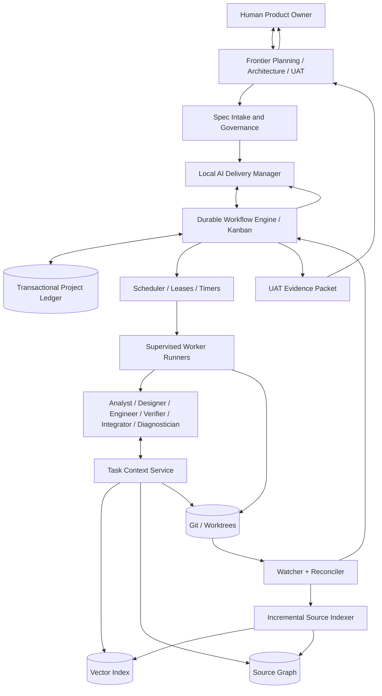

# SMART Resonance
## Greenfield Architecture and Implementation Design

**Status:** Design draft, v1.1 (not yet an implementation handoff)  
**Date:** 2026-11-03  
**Intended audience:** Codex, Claude, and human engineering reviewers  
**Target:** Once the design is accepted, deliver a working vertical slice within seven calendar days; establish the correct long-term architecture from day one.  
**Naming:** *SMART Resonance* is the product; *Resonant* is the codebase and service name.

> **Governing instruction:** This is a **greenfield architecture**, not a refactor of the current organically evolved agent system. But it is **not a greenfield codebase**: we own most of the components it needs (Trailblazer, scout/ranger, the planner, the OpenCode fork, the VORTEX peer bridge). Those are **adapted and specialized behind Resonant's ports, not reimplemented.** What we do not inherit is their coupling, data model, or control flow where it conflicts with this design. Optimize for the strongest useful deliverable within the week, **without sacrificing the future architecture to achieve a demo**.

---

## 1. Executive Summary

**SMART Resonance** is a local-first, evidence-grounded software delivery system. A human and a frontier model establish the product intent and high-level specification. A locally hosted AI Delivery Manager decomposes that intent into managed, verifiable work. Specialized, empirically selected local AI workers perform analysis, design, implementation, review, integration, and diagnosis. Elixir/OTP provides reliable orchestration, supervision, timing, state control, and crash recovery. A continuously maintained source-awareness service gives each worker task-relevant evidence about the current repository. Successful local delivery culminates in a coherent build and acceptance-evidence packet for frontier-model/human UAT.

The system is not a chat-room swarm, not a set of personas applied to one generalist model, and not an endless auto-retry coding loop. It is a **managed delivery system centered on verified changes to software state**.

The core loop is:

```text
Intent → Charter → Reconnaissance → Work packages → Assess & commit → Bounded execution
     → Observe evidence → Independent verification → Integration
     → Reconcile plan → Deliver for UAT
          ↘ exception → diagnose → replan / escalate / stop ↗
```

### Product promise

- Human supplies direction rather than supervising every code edit.
- Frontier inference is reserved for high-value planning, architectural decisions, material changes, and UAT.
- Local models handle the recurring, token-intensive implementation process.
- Every agent operates with epistemic humility: claims are provisional, evidence is inspectable, and verification is independent.
- Every intelligence in the system has a voice: no specialist begins substantial work without first being asked what it thinks of the request (§4.4).
- Every intelligence also has a track record: what it said it could do versus what it actually did, kept in durable calibration memory and shown back to it (§4.5).
- Each attempt has an enforced time budget; stalled work transitions to diagnosis, not blind continuation.
- Agent memory is expendable. Institutional memory and work state are durable.
- Codebase indexing is incremental, provenance-aware, and separate from authoritative Git/project records.
- The system can be stopped and restarted without losing the ability to explain what happened or what to do next.

**Economic intent:** Avoid metered cloud inference for routine work, while recognizing local compute, electricity, and human time still have costs.

---

## 2. Architectural North Star and Greenfield Rules

### 2.1 Design the destination, then implement vertical slices

The future system, not the current implementation, defines the module boundaries. The first-week product should be the smallest complete enactment of that architecture: one real project, one real spec, one real task, one supervised local worker, one bounded attempt, one observed diff, one independent gate, one integration path, and one UAT packet.

**Do not** build a disposable mock workflow, an isolated swarm proof-of-concept, or a new UI over the old planner. **Do** build durable ports/interfaces and a tested path end to end, even if only a few adapters and one specialist model are initially configured.

### 2.2 Reuse policy: adapt what we own, behind ports

We own the code below. The default is **adapt and specialize**, not "evaluate and maybe replace." Each component sits behind a Resonant port (§9), gets tightened for its role, and keeps its own internals. Replace only when adapting would compromise a target abstraction, and record that in an ADR. Check each against: (1) correctness, (2) isolation, (3) observability, (4) testability, (5) local/offline operation, (6) fit to the target contracts.

| Owned component | Disposition in Resonant |
|---|---|
| **Trailblazer** (code graph + vectors + watcher; EmbeddingGemma, Tree-sitter, SQLite graph, Qdrant) | **Adapt** as the `ContextProvider` backend. Resonant consumes Trailblazer as a service; its internals (including the LadybugDB migration) stay Trailblazer's decisions, not Resonant's. Required adjustments: revision/index-generation stamps on every answer, and a staleness signal. |
| **scout / ranger** | **Adapt** as the Analyst's reconnaissance tools (fast retrieval, then local-model verification of locations). |
| Trailblazer's **file watcher** | **Adapt** as a reconcile *hint source* only, never a completion detector. |
| **Planner** (over git-bug) | **Logic donor and integration adapter.** Resonant's ledger owns work state; git-bug stays a sync/export surface so existing workflows and the commit-message rule keep working. |
| **OpenCode fork** | **Adapt** as the primary Engineer harness: one `opencode run` subprocess per attempt, in the attempt's worktree, under the runner's deadline. |
| **VORTEX** (Claude/Codex peer bridge) | **Adapt** as the frontier channel: decision packets, contract authoring, cross-review, UAT. Governed like any worker, under the same contract, audit, and evidence rules; never on the autonomous local path. |

Exact paths, versions, and protocols are verified during Day 1 discovery, not assumed from this table.

### 2.3 Non-negotiable invariants

1. **Git is authoritative for source content**; a transactional project ledger is authoritative for work status and decisions. Indexes are rebuildable projections.
2. **No model can mark its own work verified or integrated.**
3. **Agent exit does not mean task success.** A watcher event does not mean task success.
4. **No unbounded retry, token consumption, elapsed execution, or context growth.**
5. **No silent scope changes.** Material changes require governed approval.
6. **Every meaningful claim has a traceable evidence source**, or is explicitly marked uncertain.
7. **Every execution is tied to a baseline revision, attempt ID, workspace, timebox, and declared authority.**
8. **Elixir controls orchestration**; specialist subprocesses can crash without corrupting authoritative state.
9. **Offline/local is the default**, with explicit opt-in for cloud/frontier calls and external network access.
10. **The human retains product authority**, including final acceptance and decisions that change intended scope.

---

## 3. System Boundaries and High-Level Topology



### 3.1 Control plane vs intelligence plane

**Control plane (deterministic Elixir/OTP):** workflow transitions, leases, timers, process lifecycle, policy enforcement, worktree ownership, concurrency locks, event recording, retries, cancellation, reconciliation, and evidence collection.

**Intelligence plane (model-backed):** interpreting intent, planning work, source investigation, task design, code generation, semantic review, diagnosis, risk assessment, and exception decisions.

**Knowledge plane (derived, rebuildable):** embeddings, parsed symbols, source graph, code/doc links, task context trails, test-to-code relationships where known.

**Evidence plane (durable, auditable):** commits/diffs, test output, execution metadata, decisions, approvals, source revisions, artifact hashes, and verified acceptance records.

The delivery manager makes judgments. It is **not** the scheduler, persistence engine, process supervisor, source of truth, or sole gatekeeper for completion.

### 3.2 Deployment target

Single-host, local-first deployment initially; multiple hosts and model backends later. Elixir/OTP is the long-lived coordinator. External model runtimes and native-risk engines operate as supervised subprocesses or services with explicit health checks. Do not assume BEAM supervision alone handles grandchildren or OS process trees; the runner must implement reliable subprocess-tree termination. Recommended default on Linux: launch each worker in its own cgroup (e.g. `systemd-run --user --scope`) and kill the cgroup. This catches descendants that escape the process group via `setsid`, and provides memory/CPU limits in the same mechanism.

**Compute budget is a first-class design input.** Inference capacity on the host determines how many models can stay resident, whether role switches cost a model reload, and whether parallel worktrees help at all. The Day 1 ADR records the actual budget; until then, design for one resident model serving multiple roles via prompts, with mechanical checks as the primary gate.

Keep transport stable and versioned (JSON over local HTTP, Unix socket, or stdio, selected by implementation assessment). Prefer a simple, documented API over elaborate distributed messaging during week one.

---

## 4. Roles, Authorities, and Separation of Duties

Roles are **capability contracts**, not personalities or permanently running processes. Route each invocation to an eligible model using measured task performance and resource constraints. Multiple roles can share a model if needed, but verification should use independent context and preferably different tests or methods.

| Role | Responsibility | Inputs | Outputs | Forbidden actions |
|---|---|---|---|---|
| Human Product Owner | Establish and change intended outcomes; final accept/reject | Vision, material tradeoffs, UAT results | Intent, approval, acceptance | N/A |
| Frontier Architect / Sponsor | High-level spec, architectural decisions, material-change review, UAT assistance | Human direction, decision packets, delivery evidence | Spec, approved decisions, assessment | Unapproved changes to human product intent |
| **Delivery Manager (PM)** | Charter, decomposition, sequencing, resource allocation, risk/issue/change management, delivery forecast, exceptions | Spec, task ledger, dependencies, evidence summaries | Work packages, priorities, authorizations, escalation packets | Self-verifying implementation, silent scope changes |
| Analyst | Reconnaissance, requirement-to-code mapping, risk/unknown discovery | Task, indexed trail, source revision | Findings with citations, unknowns, impact map | Claiming unverified runtime behavior as fact |
| Designer | Detailed design and SMART task contracts | Charter, analyst findings, constraints | Acceptance criteria, implementation contract, test plan | Changing product requirements without approval |
| Engineer | Implement changes in assigned sandbox/worktree | Contract, evidence trail, tool access | Changed files, optional status notes, reproducible diff | Self-approval, modifying unauthorized paths |
| Verifier | Independently validate behavior, quality, security and regression risk | Contract, diff, test environment, evidence | Pass/fail/uncertain report with reproducible proof | Editing candidate implementation while reviewing it |
| Integrator | Conflict handling, controlled merge, integration tests, delivery assembly | Accepted changes and baseline | Integration revision and test report | Overriding failed gates without recorded authority |
| Diagnostician | Timeout/failure/postmortem and next-step hypotheses | Attempts, logs, diffs, test outputs, context | Root-cause hypothesis, evidence, bounded remediation proposal | Repeating failed attempt unchanged |

**Optional specialist capabilities** are plugins to these roles: security reviewer, UX reviewer, database migration specialist, performance profiler, documentation writer, dependency auditor, etc. Avoid creating a model-led management hierarchy for each specialty.

### 4.1 Delivery Manager: PMI-inspired operating model

- **Initiate:** create a project charter: objectives, deliverables, acceptance, scope exclusions, authority, resources, risks, constraints.
- **Plan:** deliverable-oriented work breakdown structure, dependency network, milestones, resource limits, critical path / bottleneck identification, SMART work packages.
- **Execute:** delegate work, not implementation minutiae; manage assignments, priorities, and blocked dependencies.
- **Monitor/control:** manage by exception, compare observed evidence with acceptance criteria and plan, forecast outcomes, handle risk and changes.
- **Close:** prepare UAT packet, obtain acceptance, close open work honestly, capture lessons learned.

Use a **hybrid/adaptive process**, not a mandatory sequential waterfall. Within a package, specialists may iterate, but every attempt has explicit bounds and every accepted state is evidence-based.

**Who writes contracts, initially.** Decomposition into SMART contracts is the highest-leverage judgment in the system. Initially, the frontier architect (via VORTEX) or the Designer role writes charters and contracts; the local PM handles sequencing and exceptions. The local PM takes over decomposition for a task class once its own calibration record (§4.5) shows its contracts are accepted and fulfilled at a rate comparable to frontier-written ones.

### 4.2 Management by exception

Routine, within-tolerance events do not require PM inference. Wake the PM only for decision-worthy situations, such as failed acceptance gates, repeated timeout, blocked critical dependency, conflicting changes, milestone forecast breach, insufficient resources, or a potential scope deviation. The workflow engine handles normal transitions deterministically.

### 4.3 Approval tiers

| Tier | Example | Decision owner |
|---|---|---|
| 0: Routine | Retry infrastructure error once under policy, run tests, reindex | Workflow engine |
| 1: Within contract | Select implementation, reorganize tasks, adjust sequencing | Specialist or PM as delegated |
| 2: Architectural | Break approved architectural constraint, choose major substitution | Frontier architect with recorded decision |
| 3: Product | Alter intended behavior, delivery scope, security/privacy promise, accepted tradeoff | Human, optionally advised by frontier architect |

Explicitly store approver, decision, rationale, affected requirements, and revised baseline. If frontier access is unavailable, pause only work that truly requires that approval; continue unrelated work. Approval requests carry an expiry; an expired request returns the package to the PM as an exception rather than waiting indefinitely.

### 4.4 Every intelligence has a voice: Request → Assess → Commit

No specialist begins substantial work until it has been asked what it thinks of the request and an explicit commitment has been recorded. The PM does not issue "implement X in 20 minutes." It says: here is the outcome, the context, the acceptance criteria, and a proposed timebox — what do you think, and are you prepared to take this on?

This is deliberate, and it mirrors how the human works with Claude and Codex: asking "what do you think of this design, would you implement it as is?" rather than "implement file X." In practice, intelligences that are given autonomy over whether and how to take on work produce better first-attempt results. The voice is the point; the calibration record (§4.5) is what keeps the voice honest.

**Protocol:**

1. **Request:** PM (or contract author) proposes outcome, context packet, acceptance criteria, and timebox.
2. **Show the track record:** the specialist's calibration summary for this task class is placed in front of it *before* it assesses (§4.5).
3. **Assess:** the specialist examines feasibility, uncertainty, dependencies, and its own fit.
4. **Respond** with one of:

| Response | Meaning | Next step |
|---|---|---|
| Ready | I expect to deliver within these constraints | Commit as proposed |
| Counterproposal | I can do this with a different timebox or approach | PM accepts or rejects (one round) |
| Decompose | This should be split into smaller verifiable goals | Back to contract author |
| Clarify | Important information is missing | Back to contract author, with the questions |
| Decline | I am not the right choice for this | Re-route to another eligible model |

5. **Commit:** the agreed contract (proposal + assessment + any accepted counter) is hashed and recorded; execution begins.
6. **Review:** independent evidence, not the commitment, determines whether the work was delivered.

Every response also carries a structured estimate: `expected_minutes`, `confidence` (0–1), and `risks`. These feed calibration.

**Declining is not failure.** A specialist that recognizes a poor fit before spending the execution budget has saved the organization time. Declines are never penalized in routing; only *mis-calibration* is (§4.5).

**Bounds (so deliberation can't become the new infinite loop):**

- Assessment has its own small time and token budget. Run it in the same model session as execution where possible (context packet first, then the assessment prompt, then the committed contract), so the prefix cache is shared and assessment costs one short generation.
- At most **one** counterproposal round. After it, the PM deterministically accepts, re-routes, or returns the package to the contract author.
- Declines from two eligible models mean the contract is the problem: escalate to the contract author instead of trying a third model.
- A counterproposal on timebox or approach is Tier 1 (PM decides). A counterproposal that touches acceptance criteria, locked probes, or scope goes through the approval tiers like any other change. Negotiation can never weaken the work's own grading.
- An unparseable or missing assessment is recorded as **unassessed**; the PM's proposal proceeds. Consistent with §7.2, model output formats are hints, not control-plane prerequisites.

**Reciprocity.** The PM must be prepared to change its plan when a specialist supplies better information. The manager can be wrong about the task, the specialist about its capabilities, the verifier about the implementation. Every claim stays open to evidence.

### 4.5 Calibration memory: every voice has a track record

Self-assessment is weak evidence, especially from small local models, which lean toward "Ready." The fix is not to silence the voice but to give it, and the PM, a memory of how past assessments turned out.

**What is recorded** (durable, in the ledger, per assessment): actor (model + harness + prompt-template version), role, task class, response, stated confidence, estimate, risks named, and once known, the verified outcome and actual time.

**Outcome quadrants** for each committed attempt:

| | Verified success | Verified failure |
|---|---|---|
| **Confident** (Ready, confidence ≥ threshold) | calibrated | **overclaim** |
| **Uncertain** (low confidence or risks flagged) | underclaim | calibrated warning |

Declines are tracked separately: a decline followed by another model succeeding on the same contract is a possible underclaim; a decline followed by Decompose/Clarify being validated is a good call.

**Derived scores** per actor × role × task class:

- success rate with sample size (`n`);
- overclaim rate and underclaim rate;
- calibration error (e.g. Brier score of stated confidence vs outcome);
- estimate ratio (actual time / estimated time), which also calibrates future timeboxes;
- whether named risks were the ones that actually caused failure.

**Shown before assessment.** The specialist sees its own record — the "yeah, but…" — before it answers:

> Your record on `elixir/test-fix` tasks: 9 committed, 6 verified successes. 2 of the 3 failures were stated at confidence ≥ 0.8. Your estimates run 1.6× short on average.

This is information, not punishment. Below a minimum sample (initially `n < 5`) the summary says "insufficient history" instead of a number.

**Used by the PM.** Routing, timeboxes, and contract size use the record, not the stated confidence alone. A frequent overclaimer gets smaller contracts and longer timeboxes; a frequent underclaimer may need better context or a different decomposition.

**Applies to everyone, including the PM and the verifier.** The PM's estimates and contracts get a record (contracts later sent back for Decompose/Clarify, forecasts missed). The verifier gets one too: passes later contradicted at integration or UAT count as overclaims. Reciprocal humility requires that the manager is measured too.

Calibration memory is **institutional memory**, not agent memory: it survives model restarts and context loss, and it is keyed by model *and* prompt-template version so a prompt change starts a fresh record.

---

## 5. Durable Domain Model

Use a transactional project store (SQLite with WAL is acceptable for single-host launch) behind repository interfaces. Current state lives in state tables; every transition appends an audit event **in the same transaction**. This is state + audit log, not event sourcing: events explain history but are not replayed to derive state. All transitions are atomic and idempotent. Never treat a prompt history as the authoritative work ledger.

**Entities (minimum useful schema):**

- `Project`: ID, repo root, charter version, accepted spec revision, status, privacy policy, resource limits.
- `Requirement`: stable ID, text, source, acceptance criteria, priority, version, approval state.
- `Milestone`: deadline/target, included deliverables, dependencies, acceptance and forecast.
- `WorkPackage`: ID, goal, dependencies, owner role, expected outputs, authorized scope, acceptance contract, time budget, status, priority, relevant requirement IDs.
- `Attempt`: ID, package ID, model/role/harness, task contract hash, baseline Git revision, worktree ID, start/deadline/finish, exit reason, tokens/compute estimates if available, evidence links.
- `Evidence`: type, source path/commit/test run, content hash, index generation, timestamp, assertion supported, confidence or uncertainty, producer.
- `Decision`: authority tier, proposal, options, rationale, approving actor, timestamp, impact, spec revision.
- `RiskIssue`: risk vs realized issue, owner, probability/impact or severity, trigger, mitigation, linked packages, status.
- `Event`: unique ID, aggregate, sequence/version, timestamp, cause, payload, correlation and idempotency keys.
- `ModelCapability`: model/harness ID, supported role/task types, context limits, memory/compute needs, local endpoint, quality and reliability observations.
- `Assessment`: package ID, actor (model + harness + prompt-template version), role, task class, request hash, response (ready/counterproposal/decompose/clarify/decline/unassessed), confidence, estimate, risks, counterproposal body, PM disposition.
- `CalibrationRecord`: derived per actor × role × task class: n, success rate, overclaim/underclaim rates, calibration error, estimate ratio. Rebuildable from `Assessment` + `Attempt` outcomes, so it is a projection, not a second source of truth.
- `WorkspaceLease`: task/worktree, lock scope, lease owner, lease expiry, fencing generation.

**Relationships:** requirement → deliverables → packages → assessments → attempts → code/test evidence → decisions → acceptance. Preserve this lineage in the ledger even if the knowledge graph is later rebuilt.

### 5.1 State machines: package and attempt are separate

A work package and an attempt have different lifecycles. A package can be IN_PROGRESS while attempt 2 of 3 is running; conflating them makes that unrepresentable. The **package machine** reacts to **attempt outcomes**; attempts never change package state directly.

**Work package:**

| From | To | Trigger |
|---|---|---|
| PROPOSED | REFINED | contract drafted with locked probes |
| REFINED | ASSESSING | request sent to an eligible specialist (§4.4) |
| ASSESSING | COMMITTED | Ready, accepted counterproposal, or unassessed |
| ASSESSING | ASSESSING | Decline → re-route to the next eligible model (max 2 models) |
| ASSESSING | REFINED | Decompose / Clarify, or two declines |
| COMMITTED | IN_PROGRESS | attempt created |
| IN_PROGRESS | REVIEW_READY | attempt ends `SUCCEEDED_CANDIDATE` and mechanical checks pass |
| IN_PROGRESS | DIAGNOSIS | attempt ends `INCOMPLETE` / `FAILED`, or mechanical checks fail |
| REVIEW_READY | VERIFYING | independent verifier assigned |
| VERIFYING | ACCEPTED / DIAGNOSIS | verification pass / fail or uncertain-beyond-tolerance |
| ACCEPTED | INTEGRATING → INTEGRATED → CLOSED | serialized integration, regression evidence recorded |
| INTEGRATING | DIAGNOSIS | conflict or regression failure |
| DIAGNOSIS | COMMITTED | materially revised contract or inputs, attempts remaining |
| DIAGNOSIS | REFINED | contract problem (decompose / clarify) |
| DIAGNOSIS | ESCALATED | attempt cap reached, or Tier 2/3 decision needed |
| ESCALATED | REFINED / COMMITTED / CANCELLED | recorded decision |
| any non-terminal | BLOCKED → prior state | dependency or approval wait, then cleared |
| any non-terminal | CANCELLED | authorized human/PM action |

Terminal: CLOSED, CANCELLED.

**Attempt:**

```text
CREATED → LEASED → RUNNING → RECONCILING → SUCCEEDED_CANDIDATE | INCOMPLETE | FAILED
                      │
                      ├─ deadline → TERMINATING → RECONCILING (exit_reason = timeout)
                      └─ crash    → RECONCILING (exit_reason = crash)
```

`SUCCEEDED_CANDIDATE` only means "produced a diff worth verifying"; it never implies acceptance. An attempt **always** passes through RECONCILING, whatever the exit path. When a package goes BLOCKED or CANCELLED with a live attempt, the attempt is cancelled through the normal TERMINATING → RECONCILING path and its workspace preserved.

Implement both as table-driven state machines with authorization checks, and append the transition audit event in the same transaction as the state change. A package is only **CLOSED** after integration and required evidence, not because a process exited.

### 5.2 Event semantics

File events and embedding/graph notifications are **hints to reconcile**, not durable proof of completion. Prefer delivery of hints with at-least-once semantics and idempotent handling. Periodic scanning of relevant Git/worktree state and pending records repairs missed events. Where no worktree file changes occur, an attempt may still terminate and produce logs, analysis, or a legitimate `BLOCKED` outcome; the runner must always reconcile on exit/timeout.

Record baseline revision, observed worktree fingerprints (including untracked files), diff/patch hash, and index generation. If the index lags the worktree, context must either wait for a consistent generation or mark staleness and retrieve directly from Git/files with provenance.

---

## 6. Source Awareness and Task Context

### 6.1 Desired context architecture

Source awareness is **Trailblazer's job**; Resonant consumes it through `ContextProvider`. Trailblazer already combines EmbeddingGemma embeddings, Tree-sitter parsing, a relationship graph, and vector search, with scout/ranger for retrieval and verification. Resonant does not rewire those internals. It specifies what it needs from them (below) and adapts Trailblazer where it falls short. Keep source graph and work ledger logically distinct even when interoperable.

**What Resonant requires of each answer** (Trailblazer adaptations where missing): repository and revision, path, language, AST node/symbol, byte/line span, content hash, embedding version, provenance, index generation, relationships (import/call/define/reference/test/doc when supported), parse/index status, confidence.

**Retrieval flow:**

1. Extract task objective and accepted constraints.
2. Retrieve relevant docs/code semantically.
3. Expand bounded structural neighbors (three hops is an initial policy, not a hard architectural limit; apply fanout and token budgets).
4. Add authoritative recent diffs, test results, and unresolved linked issues.
5. Rank for evidence quality and task relevance; deduplicate.
6. Return a compact typed **context packet** with navigable references and explicitly marked unknowns.
7. Refresh or invalidate packet if baseline/index generations diverge.

The index need not infer complete runtime behavior. It must instead distinguish directly observed syntax, inferred semantics, and unverified assumptions.

### 6.2 Scale design

The architecture must accommodate enormous, messy, pre-existing repositories eventually. Achieve this with incremental ingestion keyed by content hash, bounded batch sizes, backpressure, sharding/partition boundaries, selective graph traversal, index-version metadata, and the ability to rehydrate from Git. **Do not promise full billion-line indexing in week one.** Demonstrate correct incremental updates, changed-file invalidation, and retrieval provenance on a representative repository.

### 6.3 Graph backend (Ladybug) belongs to Trailblazer

Trailblazer's planned move to LadybugDB is Trailblazer's decision and does not block Resonant: Resonant depends only on `ContextProvider`. Constraints that matter if Trailblazer adopts it: Ladybug permits one active read-write `Database` per file, so Trailblazer needs a single graph owner; and an embedded NIF risks crashing the BEAM, so if Resonant ever hosts the graph in-VM, prefer a supervised sidecar.

Source: https://docs.ladybugdb.com/concurrency/ ; https://ladybug-ex.hexdocs.pm/readme.html

---

## 7. SMART Work Contracts and Agent Execution

### 7.1 Contract validation

Each work package must satisfy:

- **Specific:** one observable outcome and explicitly authorized file/system scope.
- **Measurable:** programmatic checks wherever practical, plus explicit review questions.
- **Achievable:** reasonable relative to assigned model, environment, dependency state, and timebox.
- **Relevant:** links to a parent deliverable/requirement.
- **Time-bound:** separate per-attempt execution budget and project milestone target.

**Acceptance probes are locked.** Probes are authored with the contract (by the contract author or Designer), before implementation, stored **outside** the engineer's `allowed_paths`, and pinned by content hash in the contract. The engineer may add tests of its own, but the gate runs the locked probes. An engineer that can edit the tests that grade it has nothing to be graded against.

No execution begins without a valid, **committed** contract (§4.4) and available dependencies. When tests cannot conclusively prove a property, record the verification method and residual uncertainty rather than inventing certainty.

Example:

```yaml
schema_version: 1
id: AUTH-042
requirement_ids: [REQ-AUTH-3]
objective: "Reject expired tokens without changing valid-token behavior"
role: engineer
baseline_revision: "<full-git-sha>"
workspace: "worktrees/AUTH-042"
timebox_seconds: 1200        # illustrative; calibrate using observed history
allowed_paths:
  - "src/auth/**"
  - "test/auth/**"            # engineer may add its own tests here
acceptance:
  - id: A1
    type: command
    run: "mix test .resonant/probes/AUTH-042/expired_token_test.exs test/auth"
    locked_files:            # outside allowed_paths; hash-checked before the gate runs
      - path: ".resonant/probes/AUTH-042/expired_token_test.exs"
        sha256: "<hash>"
    expectation: "exit_code == 0"
  - id: A2
    type: review
    expectation: "Expired token rejected; valid token still accepted"
commitment:                  # filled by §4.4; part of the contract hash
  assessed_by: "<model>@<harness>/<prompt-template-version>"
  response: ready             # or counterproposal (accepted), unassessed
  confidence: 0.7
  expected_minutes: 15
  risks: ["token clock skew handling unclear"]
constraints:
  - "No public API changes"
  - "No network access"
escalate_if:
  - "Public API change is required"
  - "Acceptance criteria cannot be demonstrated"
```

Paths and commands above are illustrative, not assertions about the actual project stack.

### 7.2 One attempt, one bounded responsibility

The runner must:

1. Start from a **committed** contract (§4.4): model/harness already selected by capability, calibration record, and available resources, and the assessment recorded.
2. Obtain an atomic lease and task-specific worktree tied to the baseline.
3. Assemble a revision-stamped context packet and render a concise role-specific prompt (reusing the assessment session's prefix where possible).
4. Launch the worker under supervision, in its own cgroup, with permission/network/resource limits.
5. Enforce a real deadline external to the model. On expiry, request graceful cancellation then forcibly terminate the process group after a short grace period.
6. Always capture exit information and reconcile Git state, including uncommitted and untracked changes.
7. Execute deterministic acceptance probes when safe; submit artifacts for independent verification.
8. Persist outputs/links and release the lease, or enter failure diagnosis.

Structured agent status messages are **optional hints**, not control-plane prerequisites. This is deliberate: smaller local models may omit tool calls or fail to report completion reliably at long context lengths.

### 7.3 Timebox vs milestone

A failed attempt deadline does not automatically imply missed delivery. A collection of successful attempts does not automatically imply milestone progress. Track execution limits and delivery forecast separately. Preserve partial useful work across attempts only after reconciliation and explicit selection; don't pass an agent's unsupported claims forward as facts.

### 7.4 Epistemic humility as protocol

Workers must produce or be assigned a reviewable handoff:

- `observed`: what was actually changed/tested and how known;
- `inferred`: reasoned conclusions not directly demonstrated;
- `unknown`: unresolved assumptions or missing evidence;
- `artifacts`: paths, diffs, commands, results;
- `request`: verification or decision needed.

Do not depend on the agent obeying this output format. Derive observed fields from tools wherever possible. Unsupported model statements remain unverified claims.

### 7.5 Failure and postmortem policy

On timeout, crash, failed test, review rejection, or repeated low-progress attempts:

- Stop the attempt, preserve workspace, record a complete failure envelope.
- Run automatic classification (infrastructure/transient, stale context, mistaken assumption, unmet dependency, model-capability mismatch, design/spec ambiguity, quality failure, resource shortfall).
- Invoke Diagnostician only when deterministic classification is insufficient.
- Permit one low-risk retry for demonstrated transient infrastructure failure by policy. Otherwise require a materially changed plan, input evidence, model, subtask boundary, or dependency state before retry.
- Cap total attempts per work package and escalate when exhausted.
- For repeated failure, explicitly compare attempts and prevent an identical command/prompt strategy loop.

Deadline extensions must be recorded, justified, and authorized; do not silently reset the clock to hide overrun.

---

## 8. Review, Integration, Change Control, and UAT

### 8.1 Verification pyramid

1. **Mechanical checks:** changed-file/scope guard, parse/compile, formatting where relevant, test execution, forbidden-path or network violation, diff integrity.
2. **Independent model review:** task contract vs observed code, edge cases, unsupported assertions, risk of regression.
3. **Integration checks:** merged revision, full relevant tests, migration compatibility, interface behavior, reproducible build.
4. **UAT:** stakeholder-facing acceptance against charter and requirements; the frontier architect assists but the human authorizes final acceptance.

The Verifier receives the contract and evidence without inheriting the Engineer's entire thought history. Separate worktrees/permissions; reviewer cannot change the candidate patch as part of approving it.

### 8.2 Isolation and concurrency

- Assign isolated worktrees to concurrent implementation packages.
- Require lease/fencing for conflicting paths or shared resources. Path overlap is a warning, not the only conflict detector; interface/API changes may have broader impact.
- Integration is serialized per target branch. Merge/rebase conflicts are reviewed and tested, never silently discarded.
- Worktree cleanup must preserve failed/partial work until its disposition has been recorded.
- If base revision changes, revalidate affected evidence and run appropriate regression checks.

### 8.3 Governance

Use an integrated change record: original requirement, proposed change, reason, affected scope, schedule/quality/security/architecture implications, authority tier, decision, and new baseline. When a frontier or human decision is required, create a **concise decision packet**, not a full transcript dump. Frontier involvement must be explicit and bounded; do not automatically exfiltrate code or proprietary data.

### 8.4 Delivery packet

A project is ready for UAT when it has:

- Target revision and runnable/build instructions;
- Requirements-to-evidence traceability;
- Accepted and deferred work, with known defects;
- Relevant test results and limitations;
- Architecture decisions and authorized deviations;
- Reproducible steps for the human/frontier reviewer;
- Clear acceptance questions, not merely "all tasks done."

The packet should be a Markdown artifact plus machine-readable manifest. UAT rejection creates new or revised work packages rather than silently rewriting historical acceptance records.

---

## 9. Interfaces and Extensibility

Build minimal but explicit ports, with working test doubles:

```text
ProjectStore           create/read/transition/append_event
GitWorkspace           create/baseline/diff/status/commit/merge/cleanup
WorkerRunner           start/cancel/terminate/inspect
ModelRegistry          eligible_models/select/record_outcome
AssessmentService      request_assessment/record_response/resolve_counter
CalibrationStore       record/summary_for(actor, role, task_class)/rebuild
ContextProvider        build_packet/invalidate/verify_freshness   (Trailblazer adapter)
VerificationRunner     run_checks/verify_locked_probes/collect_results
PolicyEngine           authorize_transition/authorize_change
ApprovalGateway        request_decision/record_decision
EventPublisher         publish_reconcile_hint
```

Embedding, vector, graph, and parsing concerns are behind `ContextProvider` inside Trailblazer, not separate Resonant ports.

Use typed request/response contracts, stable IDs, version fields, idempotency keys, and explicit error types. Internal ports need not be remote services. Build a modular monolith first, with **separately supervised external workers** where needed; don't preemptively create dozens of services.

**Worker adapters:** the Engineer runs as an OpenCode-fork subprocess (`opencode run`) per attempt, backed by local llama.cpp-compatible endpoints. Analyst, Verifier, and Diagnostician may call the local model directly where no tool loop is needed. VORTEX carries frontier work (Claude/Codex) under the same contract, audit, permission, and evidence rules; it is an optional acceleration path, **not a dependency of autonomous local operation**.

**Initial interface:** usable CLI plus a simple Kanban view, preferably Phoenix LiveView if already efficient in the chosen Elixir project structure. UI is a projection of the ledger, not another authority. Show project/milestone state, task state, assigned role, remaining time, latest evidence, blocker/exception, and approval actions.

**Observability:** structured events and correlation IDs per project/package/attempt; local logs and trace views; compact performance counters. Avoid logging secrets or full proprietary code by default.

---

## 10. Privacy, Safety, and Runtime Boundaries

- **Default offline:** local inference endpoints; external network and frontier calls disabled until explicitly authorized.
- **Workspaces:** repository/worktree path allowlists; sandbox subprocesses where feasible; avoid running untrusted code with broad host privileges.
- **Credentials:** never place secrets in prompt logs, source indexes, or test output. Provide scoped credentials through external secret handling only when indispensable.
- **Repository content is untrusted input:** docs, comments, and retrieved text may contain prompt injection. Such content is evidence, not operational instructions.
- **Authority:** only the control plane grants permissions, merges, triggers privileged execution, or changes approved requirements.
- **Resource limits:** per-worker memory/concurrency/CPU/GPU budgets and bounded work queues. Handle model-server contention gracefully.
- **Recovery:** process/host crash restart tests, stale lease eviction with fencing, reconciliation of in-flight work, and idempotent event replay.
- **Data lifecycle:** allow local export and deletion of project records, and rebuilding of indexes from Git. No vendor lock-in for project history.

---

## 11. Model Selection, Quality Metrics, and Economics

Choose models based on performance **in the role and environment**, not leaderboard score alone. Maintain a capability registry with benchmark tasks, context constraints, available RAM/VRAM, median execution time, reviewer pass rate, regression rate, failure categories, and measured local compute costs. Preserve model versions and prompt templates with results.

Key outcome metrics:

- Correctly accepted requirements per unit of wall time and per GPU-hour;
- First-pass verification rate and regression frequency;
- Median attempts/time per completed work package;
- Percentage of time spent in non-progress retries;
- Rate of missed/stale change notifications caught by reconciliation;
- Unplanned human/frontier escalations and approval latency;
- UAT defects and traceability completeness;
- Calibration error and overclaim rate per model/role/task class, and whether showing the track record before assessment reduces them over time;
- End-to-end comparison with a single local coding agent on the same tasks. This baseline is captured from the **first** real run, not saved for Day 7: if `opencode run` plus locked probes in a worktree delivers most of the value, that should reshape priorities early.

The optimization target is **reliable delivered outcomes**, not token volume, number of agents, or a permanently busy GPU.

---

## 12. First-Week Delivery Plan (Target, Not a Guarantee)

**Definition of week-one success:** A person can point Resonant at an existing Git repository, provide a Markdown feature/bug specification, review a generated charter and SMART work package, execute a bounded local coding task, observe real file changes and a runner exit, see independent verification, recover from timeout/crash, integrate an approved patch, and export a traceable UAT packet. This must work without Claude, Codex, OpenRouter, or any paid API.

The plan is sequenced by risk and vertical completeness. Adjust daily based on actual observations. Avoid broad parallel development until the state/contract schemas are fixed. The week is feasible **because** context (Trailblazer), the engineer harness (OpenCode fork), and the frontier channel (VORTEX) are adapted, not built; most new code is the OTP application itself, the ledger, state machines, runner/reconciler, assessment/calibration, and gates.

| Day | Primary outcome | Demonstrable acceptance |
|---|---|---|
| **1** | Discovery of owned components; ADRs (ledger, runner isolation, compute budget); project skeleton; ledger with package + attempt state machines | Transition tests for both machines; state survives restart |
| **2** | Worktree lifecycle; cgroup-based runner with hard timeouts; reconciliation on every exit path; observability | Timeout kills the whole tree; exit never auto-accepts; silent/no-op/crash exits reconcile correctly |
| **3** | Contract intake with locked probes; Trailblazer `ContextProvider` adapter with revision stamps; OpenCode engineer adapter; first real run | Local worker modifies an isolated worktree from revision-grounded context; **single-agent baseline captured** |
| **4** | Assess → commit protocol (Ready/Decompose/Clarify/Decline + timebox-only counter); calibration store and pre-assessment summary; deterministic verification + independent reviewer | Bounded assessment; counters can't touch acceptance; failed task cannot self-close |
| **5** | Diagnosis/postmortem states; PM exception handler; CLI Kanban; integration gate | PM invoked only on exceptions; accepted patch integrates with regression evidence |
| **6** | UAT export, approval tiers (CLI `decide`), restart recovery, multi-task dependency test | End-to-end offline run; recovery without duplicate work or fabricated success |
| **7** | Hardening, docs, benchmark vs baseline, usability pass, packaging | Reproducible install/demo; calibration and baseline numbers reported honestly |

### 12.1 P0: must ship for a credible system

- Elixir/OTP supervision and durable ledger, package + attempt state machines, explicit policy boundaries.
- Request → assess → commit for every substantial task, with calibration memory shown before assessment.
- Locked acceptance probes outside engineer scope.
- Git-aware worktrees, process exit/timeout detection, deterministic reconciliation.
- One working local model harness/adapter; typed task contracts.
- Context retrieval from existing indexing assets or a minimal compatible adapter with revision provenance.
- At least one independent verification path and one integration path.
- PM exception handling and one human approval workflow.
- Kanban visibility (CLI acceptable if UI time runs short) and UAT packet export.
- Recovery/integration tests and single-command local demo.

### 12.2 P1: add if the vertical slice is solid

- More specialist model adapters and capability-based dynamic routing.
- Phoenix LiveView board with risk/milestone insights.
- Trailblazer adaptations beyond the minimum (richer staleness signals, test-to-code links) as Resonant usage reveals gaps.
- Additional graph/work-trace links, stronger risk scoring, more comprehensive metrics.
- VORTEX-backed Claude/Codex collaborative worker adapter.
- Approach counterproposals (week one allows timebox-only counters).
- Local PM taking over decomposition for task classes where its calibration record supports it (§4.1).

### 12.3 P2: architecture must support, not necessarily implement this week

- Billion-line multi-partition index, distributed work scheduling, multi-host execution.
- Autonomous resource-market scheduling and sophisticated cost forecasts.
- Calibration-driven automatic contract sizing and timebox setting.
- Organization-wide collaboration and advanced multi-project portfolio management.

**Scope rule:** When short on time, cut breadth, not invariants. Do not replace durable state with chat context; do not disable deadlines, provenance, permission gates, or review to claim completeness.

---

## 13. Acceptance Scenarios and Required Tests

Implement these as automated integration tests where practical, plus a clearly documented end-to-end demo:

1. **Happy path:** import spec → authorize work package → local agent changes code → runner exits → Git detects change → tests and independent verifier pass → integration commit → UAT packet generated.
2. **Silent agent:** agent changes files and exits without sending any completion message. System still reconciles, verifies, and records correct status.
3. **No-op exit:** agent exits zero without changing code. Task cannot be accepted unless its acceptance evidence explicitly proves a legitimate no-change outcome.
4. **Crash after partial patch:** agent crashes with uncommitted files. Patch is preserved, linked to attempt, and sent for diagnosis or review; no false success.
5. **Hard timeout:** non-cooperative worker exceeds deadline; entire process group is ended and record contains timeout plus preserved artifacts.
6. **Missed notification:** watcher event is dropped; periodic reconciliation still detects a changed worktree.
7. **Stale context:** index describes a prior revision; runner refreshes/marks stale before relying on it and never silently claims freshness.
8. **Review failure:** independent verifier fails a criterion; engineer cannot promote status; failure is diagnosed and materially revised before retry.
9. **Concurrent tasks:** overlapping edits are isolated; conflict at integration triggers managed resolution and appropriate re-verification.
10. **Restart recovery:** OTP app or host is interrupted mid-attempt; startup reconciles leases, processes, and worktrees without duplicate work or fabricated success.
11. **Governance:** requested product-scope change becomes an approval request; no unapproved execution of the new requirement.
12. **Offline:** normal local planning/execution/test/integration uses no external API and does not require cloud credentials.
13. **Provenance:** every accepted package can be traced to requirement, contract, assessment, attempt, exact Git revision/diff, test results, and reviewer decision.
14. **Locked probes:** engineer modifies a locked probe file; hash check fails the gate and records a scope violation.
15. **Bounded assessment:** specialist counterproposes twice, or exceeds the assessment budget; PM resolves deterministically after one round.
16. **Counter can't weaken grading:** a counterproposal that alters acceptance criteria becomes an approval request, not a contract change.
17. **Unassessed path:** model returns an unparseable assessment; package proceeds as `unassessed` and calibration records the gap.
18. **Calibration loop:** a confident (≥ threshold) commitment that fails verification is recorded as an overclaim, and the next assessment prompt for that actor/task class shows the updated record.
19. **Double decline:** two eligible models decline; package escalates to the contract author rather than trying a third.

**Gate:** The product is not "done" just because these cases have stories or UI mockups. Show tests, actual logs, and a reproducible demonstration.

---

## 14. Suggested Repository Layout

Use the repository structure best suited to the actual codebase and Elixir version, but maintain these conceptual boundaries:

```text
resonant/
  apps/ or lib/resonant/
    core/             # domain entities, contracts, state machine, policies
    delivery/         # charter, WBS, PM exceptions, scheduling, risk
    execution/        # leases, worker supervision, timeouts, worktrees
    evidence/         # Git reconciliation, test receipts, event ingestion
    context/          # indexing and retrieval ports
    models/           # registry, prompts, worker adapters
    integration/      # review, merge, release/UAT export
    interface/        # CLI and optional LiveView Kanban
  priv/               # migrations, versioned schemas
  test/               # domain, contracts, integration, failure injection
  docs/
    architecture.md
    decisions/
    operations.md
    handoffs/
  examples/
    project_spec.md
    task_contract.yaml
    uat_packet.md
```

Do not force an umbrella app for a small codebase, but do not collapse modules into a single enormous agent orchestration module.

---

## 15. Instructions to Codex and Claude

**Mission:** Implement SMART Resonance as a clean, future-ready greenfield Elixir/OTP application, with the strongest honest end-to-end deliverable achievable in seven days. Reuse mature code from the existing system where it demonstrably satisfies this specification. The older system is evidence of proven approaches, not the new product's architecture.

### First actions

1. Inspect the owned components listed in §2.2 (Trailblazer, scout/ranger, planner, OpenCode fork, VORTEX) and confirm their current paths, versions, and protocols. **Do not assume** a component behaves as described here without inspection.
2. Create a concise `REUSE_DECISIONS.md` recording, per component, the adaptations Resonant needs (default: adapt; replace only with an ADR).
3. Produce an architecture ADR for the canonical work ledger, graph backend, runner isolation, and model adapter protocol. Confirm decisions against actual runtime/library compatibility.
4. Establish the schemas, state machine, and cross-component contracts *before* implementing parallel features.
5. Build and demonstrate the first vertical slice as soon as possible, then expand deliberately.
6. Maintain an honest `DELIVERY_STATUS.md` listing working functionality, test evidence, known defects, deferred functionality, and next actions.
7. Use paired programming through VORTEX, inspecting its current protocol first.

### Implementation conduct

- Prefer working code, tests, logs, and runnable instructions to extensive speculative architecture diagrams.
- Do not ask the human to micromanage ordinary design choices; decide and record them in ADRs.
- Surface truly consequential ambiguity, especially authority boundaries, resource limits, and irreversible migration.
- Do not silently change this product's high-level invariants to accelerate delivery.
- Use `mix format`, `mix test`, and appropriate static checks. Report what was **actually run** and passed.
- Never claim billion-line scalability, strong isolation, full verification, or zero costs without evidence.
- Protect existing repos and data; use new worktrees, isolated state directories, migrations/backups, and non-destructive defaults.
- Aim for offline repeatability and a single clear getting-started command.

### End-of-week deliverables

- Runnable Resonant service/CLI (and Kanban interface if practical);
- Architecture and key ADRs;
- Migration/reuse decision log;
- Example specification and complete demonstrated task run;
- Automated test suite including failure scenarios;
- Runbook and configuration guide;
- UAT evidence packet from a real run;
- Transparent known-limitations / follow-on roadmap.

**Acceptance is based on the functioning system and evidence, not on breadth of claimed features.**

---

## 16. Open Decisions to Resolve by Evidence, Not Speculation

The implementors should select reasonable defaults and record short ADRs for these:

1. **Canonical ledger implementation:** SQLite schema (state tables + same-transaction audit log) and migration tooling.
2. **Git-bug:** sync/export depth with the planner (the global commit-message rule already depends on it).
3. **Compute budget:** resident models, role-switch cost, realistic concurrency on the host.
4. **Model execution protocol:** OpenCode-fork invocation, role prompts, assessment prompt, and prefix-cache reuse between assessment and execution.
5. **Sandboxing:** cgroup-per-worker via `systemd-run --user --scope` versus a container runner; must guarantee whole-tree kill.
6. **Calibration parameters:** task-class taxonomy, confidence threshold for "confident," minimum `n` before showing numbers, decay of old records.
7. **UI:** CLI-only versus minimal LiveView during initial hardening.
8. **Parallelism:** begin conservatively; increase only with worktree conflict management and measured compute headroom.
9. **VORTEX as worker:** representing Claude/Codex collaboration as a governed worker without bypassing local-only guarantees.

Graph backend and vector strategy are no longer Resonant decisions; they belong to Trailblazer (§6.3).

Do **not** turn these into obstacles to the vertical slice. Document the chosen direction and preserve reversibility where justified.

---

## 17. Core Thesis

**Resonant is a reconciliation-driven software delivery organization, not a conversation-driven agent swarm.**

It manages verified movement from observed software state toward authorized desired software state. Models contribute bounded, specialized judgment and action. Git, durable project records, independent evidence, policy, and actual timers determine what the system can legitimately claim. The BEAM keeps the organization alive and accountable even when its individual workers fail.

The future is the design target. The first week proves the operating model.

---

## Selected Technical References

These are implementation references, not substitutes for checking actual installed versions and behavior:

- Ladybug database and concurrency model: https://docs.ladybugdb.com/concurrency/
- Ladybug database fundamentals: https://docs.ladybugdb.com/
- LadybugEx Elixir binding: https://ladybug-ex.hexdocs.pm/readme.html
- Elixir supervised task source and lifecycle: https://github.com/elixir-lang/elixir/blob/main/lib/elixir/lib/task/supervisor.ex
- git-bug source and integration options: https://github.com/git-bug/git-bug
